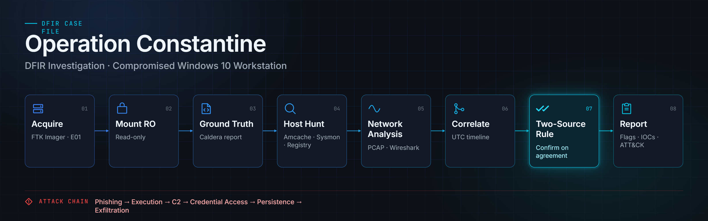

# Operation Constantine — DFIR Investigation of a Compromised Windows 10 Workstation



> **Report 21 · Purple Team Bootcamp (Golden)**
> Adversary Emulation & Digital Forensics / Incident Response (DFIR)
> Analyst: **Mohammed Rida Lakhdari**

A full end-to-end DFIR investigation of a Windows 10 workstation compromised during a MITRE Caldera adversary-emulation exercise. This repository reconstructs the entire intrusion — from the phishing email that got the attacker in, through credential theft and persistence, to two rounds of data exfiltration — and backs every single finding with at least two independent pieces of evidence.

---

## TL;DR

A finance workstation was tricked into running a malicious script delivered by a fake "IT Security payroll update" email. That script dropped a remote-control agent that talked to the attacker's server, dumped Windows passwords from memory, created a hidden backdoor account, bundled stolen data into ZIP files, and shipped them out over the same channel it used for commands. The attacker then tried to cover their tracks by clearing event logs and deleting files.

Despite the anti-forensics, the investigation recovered the complete story: **26 confirmed attack techniques** mapped to MITRE ATT&CK, a minute-by-minute UTC timeline, indicators of compromise, and ready-to-deploy detection rules.

---

## The scenario in plain terms

| Thing | Detail |
|-------|--------|
| **Victim machine** | `DESKTOP-2A1O8LD` — Windows 10, logged in as user `anmar`, IP `192.168.67.129` |
| **Attacker's server (C2)** | `192.168.67.128` on port `8888` (a MITRE Caldera server) |
| **How they got in** | Spear-phishing email with a malicious Python attachment (`NulltackKatz.py`) |
| **What they planted** | Two remote-control agents: `splunkd.exe` and `anmar_hacking.exe` (disguised to look legitimate) |
| **The date of the attack** | July 5, 2026 (all times in this report are UTC) |

Everything here was done on an **isolated analysis machine** against a **forensic copy** of the disk. Nothing touched the live evidence. Indicators of compromise are "defanged" (e.g. `hxxp://`, `192.168.67[.]128`) so you can't accidentally click or run them.

---

## How the attack unfolded (the kill chain)

Read top to bottom — this is the order the attacker did things.

### 1. Initial Access — the phishing email
A spoofed email pretending to come from `security@payroll-update[.]com` with the subject **"URGENT: Payroll System Security Update Required"**. It used authority + urgency (threatening a lockout and delayed salary) to pressure the user into opening the attached `NulltackKatz.py`. The email was recovered intact from the machine.
*(MITRE: T1566.001 Spearphishing Attachment)*

### 2. Execution — the malicious binary that no longer exists
Running the attachment led to `splunkd.exe` being executed at **06:13:27 UTC**. The attacker later **deleted** this file from disk — but Windows keeps a forensic breadcrumb called **Amcache** that recorded the file's hash and its first-run time anyway. This single artifact proves a file existed and ran even though it's gone. A second agent, `anmar_hacking.exe`, appeared at 06:38:48 UTC.
*(MITRE: T1204.002 User Execution)*

### 3. Command & Control — phoning home
The agents beaconed back to the attacker's server at `hxxp://192.168.67[.]128:8888` over plain HTTP. The network capture confirmed this with two fingerprints: a `Go-http-client/1.1` user-agent (Caldera's agent is written in Go) and a `Python/aiohttp` server banner (Caldera's server).
*(MITRE: T1071.001 Web Protocols)*

### 4. Credential Access — stealing passwords from memory
At **07:27:10 UTC**, PowerShell was used to download and run **Invoke-Mimikatz** straight into memory (never touching disk) to dump credentials from the `lsass.exe` process. The network capture independently confirmed this by catching the exact moment PowerShell reached out to GitHub to grab the tool.
*(MITRE: T1059.001 PowerShell, T1003.001 LSASS Memory)*

### 5. Persistence — a hidden backdoor account
At **08:20:22 UTC** the attacker created a hidden local account literally named `$` with the password `ATOMIC123!`. Accounts ending in `$` don't show up in the normal `net user` listing — that's the trick. This was confirmed two ways within ~30 milliseconds of each other: the process-creation log and the Windows account database (SAM hive) both recorded it.
*(MITRE: T1136.001 Create Account, T1564.002 Hidden Account)*

> **A finding that's actually a non-finding:** the investigation also checked every registry "Run key" (the classic auto-start persistence spot) and found them **clean**. The attacker relied on manually re-deploying their agent instead. Proving something *didn't* happen is just as valuable as proving it did — so it's documented explicitly.

### 6. Collection & Staging — bundling the loot
Stolen data was packed into `staged.zip` inside `C:\Windows\system32\staged\`. The USN Journal (a change log NTFS keeps) showed the archive being re-created right before the second exfiltration run.
*(MITRE: T1560.001 Archive via Utility)*

### 7. Exfiltration — two shipments
Two `POST /file/upload` requests sent the staged ZIPs to the attacker's server, at **07:21:59 UTC** and **08:28:32 UTC**, both answered with `200 OK`.
*(MITRE: T1041 Exfiltration Over C2 Channel)*

### 8. Anti-forensics — covering tracks (and failing)
The attacker cleared Windows event logs around **07:01 UTC** and deleted the staged archive after exfiltration. It didn't fully work: key telemetry survived the log clear and was recovered.
*(MITRE: T1070.001 Clear Event Logs, T1070.004 File Deletion)*

---

## How the investigation was done (methodology)

The investigation followed a **"source-of-truth first"** workflow so that nothing was assumed:

1. **Acquire** — created a forensic `E01` disk image with FTK Imager, verified by MD5/SHA1 hashes (chain of custody).
2. **Mount read-only** — the image was mounted so files could be read but never changed.
3. **Parse the ground truth** — the Caldera operation report (JSON) was read first to get an independent list of what the attacker was *supposed* to have done, then used as an oracle to validate the forensic evidence.
4. **Hunt across host artifacts** — Amcache, Sysmon logs, registry hives, the USN Journal, and Prefetch were queried per technique (using Eric Zimmerman's tools).
5. **Correlate with network evidence** — the packet capture (PCAP) was analyzed in Wireshark and time-aligned with the host events.
6. **Apply the two-source rule** — a finding is only "confirmed" when **two independent sources agree**. Everything else is flagged as inferred or ambiguous.
7. **Build the timeline and detections** — all confirmed events normalized to a single UTC timeline, and detection rules derived from them.

---

## Key evidence sources

| Source | What it told us |
|--------|-----------------|
| **Amcache** | Recovered the hash and first-run time of the deleted `splunkd.exe` — the single strongest artifact in the case |
| **Sysmon** (EID 1/3/10/11/13) | Process creation, network connections, and LSASS access events |
| **Registry hives** (SAM / SYSTEM / SOFTWARE / NTUSER) | The hidden `$` account, the clean Run keys, the legitimate-vs-malicious `splunkd` distinction |
| **USN Journal** ($J) | The lifecycle of `staged.zip` (created, deleted, re-created) |
| **Prefetch** | A dense cluster of discovery/evasion tools the attacker ran |
| **PCAP** (Wireshark) | C2 beacons, the decoded agent profile, exfiltration POSTs, and the TLS handshake that grabbed Mimikatz |

---

## Unified UTC timeline (highlights)

| Time (UTC) | Event |
|------------|-------|
| 06:12:04 | Windows Defender disabled via the Security Center GUI |
| 06:13:27 | Malicious `splunkd.exe` first executed |
| 06:38:48 | Second agent `anmar_hacking.exe` first seen |
| 07:01:41 | Event-log discontinuity (logs cleared) |
| 07:16:43 | First successful C2 beacon |
| 07:21:59 | Exfiltration cycle 1 (~155 kB uploaded) |
| 07:27:10 | PowerShell Invoke-Mimikatz credential dump |
| 08:20:22 | Hidden `$` account created |
| 08:27:44 | `staged.zip` re-staged |
| 08:28:32 | Exfiltration cycle 2 |
| 08:48:09 | On-disk `mimikatz.exe` + discovery tools run |

---

## Indicators of Compromise (defanged)

| Type | Indicator |
|------|-----------|
| C2 server | `hxxp://192.168.67[.]128:8888` |
| Malicious binary | `C:\Users\Public\splunkd.exe` |
| SHA1 (splunkd) | `84b3ad73cfa4654fcdafd162a0cb1527c4bad510` |
| Agent binary | `C:\Users\Public\anmar_hacking.exe` |
| SHA1 (agent) | `90b54b721c6a06e80377b2000db7195c62c3d19d` |
| Agent "paw" ID | `qktity` |
| Hidden account | `$` / password `ATOMIC123!` |
| Phishing sender | `security@payroll-update[.]com` |
| Phishing attachment | `NulltackKatz.py` |
| Staged archive | `staged.zip` (in `C:\Windows\system32\staged\`) |

---

## Detection engineering

The report doesn't stop at analysis — it ships working detection content so this attack would be caught next time:

- **Sigma rule** — flags creation of a hidden local account whose name ends in `$` (`net user ... /add`). *(T1564.002)*
- **YARA rule** — fingerprints the `NulltackKatz.py` dropper using confirmed infrastructure strings (C2 endpoint, agent names, deploy group). *(T1566.001 / T1204.002)*
- **Incident Response Playbook** — a scoped containment → eradication → recovery → lessons checklist, where every action references the specific IOC or finding that justifies it.

Detection opportunities also include: alerting on `splunkd.exe` running from any path other than `Program Files\Splunk`, PowerShell download cradles reaching out to `raw.githubusercontent.com` with `-ExecutionPolicy Bypass`, repeated `POST /file/upload` to untrusted hosts, and event-log-clear alarms (EID 1102).

---

## What's in this repo

```
.
├── README.md                          # You are here
├── Mohammed_Rida_Task21_Report.pdf    # The full 43-page DFIR report
├── KG/                                # Knowledge graph (Obsidian) — concepts, techniques, IOCs linked together
└── Screenshots/                       # Figures and evidence captures referenced in the report
```

- **The PDF** is the complete report: evidence acquisition, host & network analysis, all 12 scenario flags resolved, the full ATT&CK mapping, and the appendices.
- **`KG/`** holds the Obsidian knowledge graph that models the whole scenario — kill chain, telemetry, and IOCs — as linked notes, so no step sits in isolation.
- **`Screenshots/`** holds the tool output and evidence captures used as figures throughout the report.

---

## MITRE ATT&CK coverage

**26 techniques confirmed** across host and network evidence, plus 1 documented negative (Run-key persistence). Tactics covered: Initial Access, Execution, Persistence, Privilege Escalation, Defense Evasion, Credential Access, Discovery, Command & Control, Collection, and Exfiltration.

---

## Lessons learned (the takeaways worth keeping)

- **Deleted binaries are still provable.** Amcache rebuilt the hash and first-run time of a file the attacker wiped.
- **Negative findings are findings.** Proving no registry persistence existed is as useful as proving it did.
- **Timezone discipline is non-negotiable.** The analysis clock was offset; every timestamp here is anchored to UTC, never the misleading local `TimeCreated`.
- **Acquisition hygiene matters.** Booting evidence for live parsing injects artifacts — those were identified and excluded. Offline read-only mounting avoids the problem.
- **Masquerade ≠ confirmed technique.** A file *named* like a system process isn't proof of the technique; the report separates name tricks from the real credential dump to avoid false attribution in either direction.
- **Cross-source corroboration is the gold standard.** The agent's ID and process ID appeared simultaneously in the network capture and the host logs — independent agreement on who did what.

---

*All analysis performed in an isolated lab against a forensically acquired image. IOCs are defanged throughout per standard reporting practice.*
